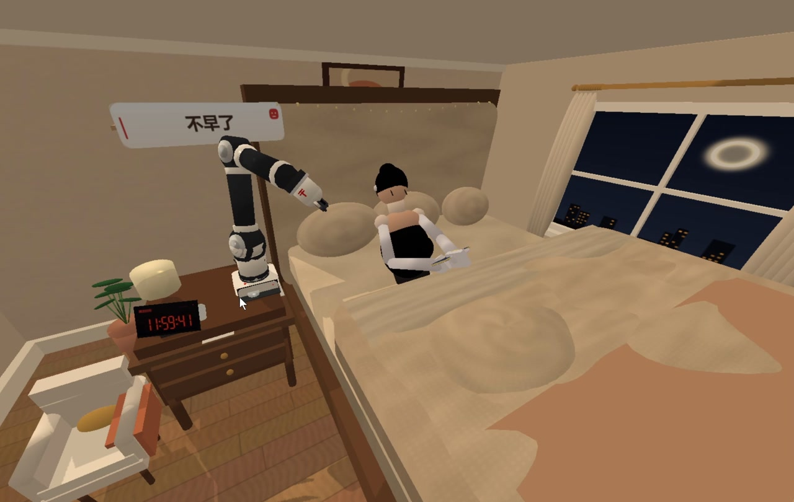
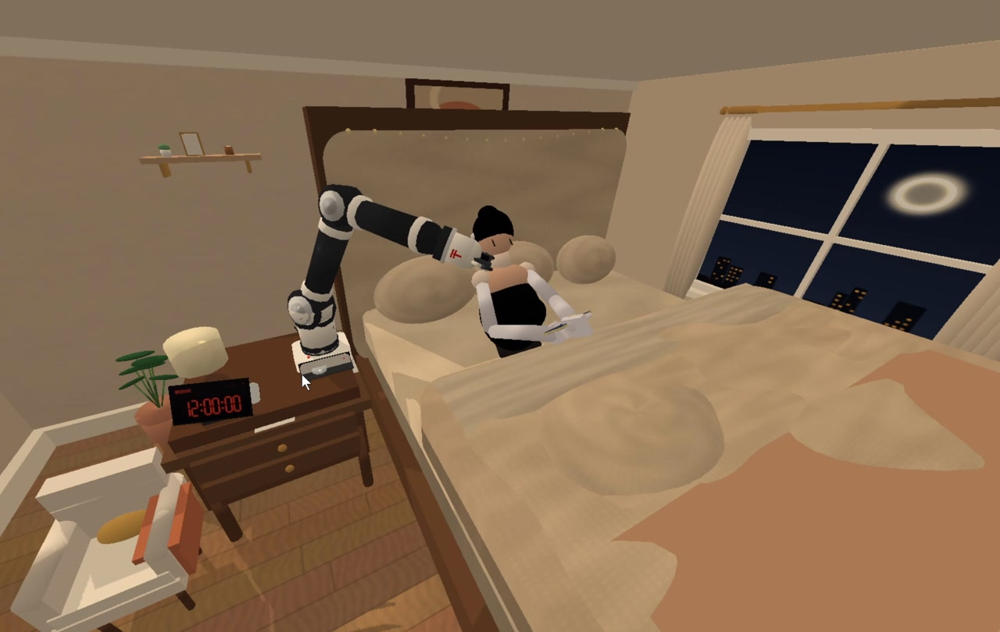
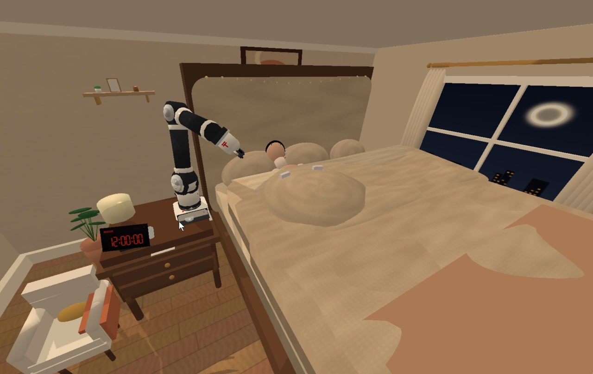
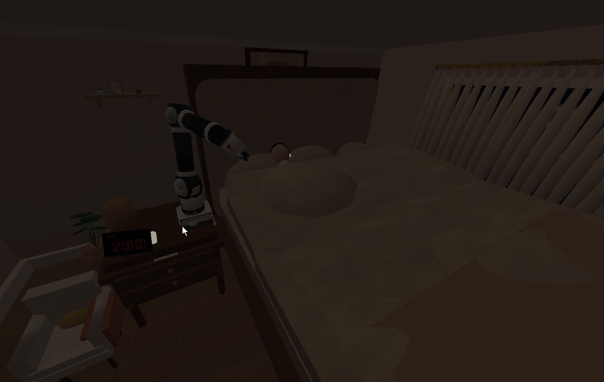

# 夺机追梦者｜睡前守护机器人

基于 **Python + PyBullet** 的三维睡前伴护场景演示。作品围绕“睡前放不下手机”的生活情境，将中文提醒、机械臂抓取收纳、人物拉被入眠、灯光与窗帘联动、助眠音乐组织成一段连续的小剧场。

当前交付为软件仿真 Demo：主要动作由预设时间轴、运动学计算与位姿插值驱动，用于展示交互流程和场景设计。

[观看功能演示视频](media/bedtime-demo.mp4) · [查看技术文档](docs/夺机追梦者_技术文档.docx)

[](media/bedtime-demo.mp4)

*图片来自已有运行录屏。演示视频约 81 秒，包含片头、分段说明与片尾；程序核心剧情约 41 秒，另有约 1 秒开场缓冲。视频播放时间与程序剧情时间不一一对应。*

## 作品功能

| 功能 | 演示内容 |
| --- | --- |
| 睡前提醒 | 电子钟从 `11:59:40` 推进至 `12:00:00`，机器人依次显示并播报“不早了”“该睡觉了” |
| 手机抓取 | 机械臂伸出、张爪对准、下探、收拢抓指，手机随后跟随机械爪移动 |
| 手机收纳 | 将手机送入底座侧面的抽屉，松爪、撤回并关闭抽屉 |
| 归还提示 | 显示并播报“手机将于次日早上6点整归还” |
| 拉被入眠 | 人物双手抓住被沿、躺下、拉起被子并切换睡眠表情 |
| 环境联动 | 播放程序生成的八音盒助眠曲，灯光逐渐变暗，右侧窗帘合拢 |
| 展示操作 | 支持暂停、重播、视角调整及指定剧情时间点的截图导出 |

### 演示截图

| 提醒与卧室场景 | 机械臂抓取手机 |
| --- | --- |
|  |  |

| 人物拉被躺下 | 灯光与窗帘联动 |
| --- | --- |
|  |  |

## 快速开始

建议使用 **Windows 10/11、64 位 Python 3.11** 和支持 PyBullet GUI 的图形环境。完整音频体验依赖 Windows `winsound`；缺失语音文件时还需要系统中文 TTS。仓库已包含贴图、网格、四句语音与助眠曲。

下载并解压仓库，在包含 `夺机追梦者.py` 的目录打开 PowerShell：

```powershell
python -m venv .venv
.\.venv\Scripts\python.exe -m pip install -r requirements.txt
.\.venv\Scripts\python.exe ".\夺机追梦者.py"
```

上述命令直接使用虚拟环境解释器，无须激活环境。依赖安装需要网络；资源齐全后，演示本身无需联网。

默认窗口为 1920 × 1080，可通过参数调整：

```powershell
.\.venv\Scripts\python.exe ".\夺机追梦者.py" --width 1280 --height 720
```

`requirements.txt` 包含 `pybullet`、`numpy` 和 `Pillow`。其中 Pillow 用于程序化纹理及缺失资源的补绘。依赖未锁定版本，本次整理未进行本机安装或运行验证。

### 交互操作

| 操作 | 作用 |
| --- | --- |
| `SPACE` | 暂停／继续剧情；助眠曲停止后，继续时重新播放 |
| `R` | 重置并重新播放剧情 |
| `Q` 或 `ESC` | 退出窗口 |
| PyBullet 默认鼠标相机操作 | 调整观察视角、缩放场景 |

## 剧情时间轴

下表使用主程序中的剧情秒数。时钟按剧情时间每秒跳动一格，20 秒后固定显示 `12:00:00`；它不是系统实时时钟。实际播放耗时还受加载、暂停和渲染速度影响。

| 剧情时间 | 动作 |
| --- | --- |
| 0–8 秒 | “不早了”，人物继续看手机 |
| 10–18 秒 | “该睡觉了” |
| 20–21.40 秒 | 伸臂、张爪，接近手机 |
| 21.40–21.95 秒 | 下探并对准手机 |
| 21.95–22.45 秒 | 收拢抓指，完成抓取姿态 |
| 22.45–26.00 秒 | 抽离手机、运送并放入抽屉 |
| 26.00–26.70 秒 | 抽屉关闭；机械臂随后归位 |
| 26.80–30.00 秒 | 显示次日 6 点归还提示 |
| 32.00–34.50 秒 | 显示助眠曲提示 |
| 34.50–37.85 秒 | 人物抓被、拉被、躺下入眠 |
| 38–41 秒 | 灯光渐暗、窗帘合拢；助眠曲在语音播报空闲后启动 |
| 41 秒后 | 保持夜间场景，等待重播或退出 |

字幕显示按时间轴切换，实际语音长度取决于音频文件和系统语音；不应将字幕区间视为音频播放完成的精确时刻。

## 技术实现

- **程序化场景**：通过 PyBullet 图元、OBJ 网格与纹理构建房间、家具、人物和机器人。
- **机械臂与抓指**：使用运动学计算、轨迹插值和参数化指节姿态组织抓取动作；手机位置在抓取后由代码同步到机械爪附近。
- **平滑轨迹**：结合五次缓动函数与贝塞尔路径。源码中的 `bezier5` 使用五个控制点，数学上是四次贝塞尔曲线。
- **人物与被褥联动**：姿态、手部、表情和多个被褥部件随剧情时间共同更新；被褥采用分层几何体与插值动画。
- **中文声音**：台词 WAV 缓存与后台队列用于串行播放；助眠曲通过 NumPy 合成。
- **资源路径兼容**：Windows 中文路径下，将资源同步到可用的 ASCII 缓存目录，降低底层纹理加载失败的风险。
- **截图输出**：支持超采样与图像后处理，便于制作展示材料。

### 当前实现范围

本作品展示预设场景内的伴护流程，尚未实现实体机器人控制、视觉识别手机、接触力闭环抓取或柔性布料动力学。“次日 6 点归还”是剧情提示，当前程序没有实际等待到 6 点并返还手机的流程。

## 文件结构

```text
.
├── README.md
├── requirements.txt
├── .gitignore
├── 夺机追梦者.py          # 场景、时间轴、交互、语音和截图入口
├── robot_rig.py           # 机械臂、夹爪与抽屉
├── woman_rig.py           # 人物姿态、手部、表情与手机位姿
├── meshgen.py             # 程序化 OBJ 网格
├── textures.py            # 程序化纹理
├── pngutil.py             # PNG 写入
├── assets/                # 网格、材质、字幕、钟面、手机屏幕及音频
├── docs/
│   ├── 夺机追梦者_技术文档.docx
│   └── images/            # 从已有录屏提取的 README 配图
└── media/
    └── bedtime-demo.mp4   # 已录制的功能演示视频
```

## 导出剧情截图

如需自行生成新截图，可使用源码已有参数：

```powershell
.\.venv\Scripts\python.exe ".\夺机追梦者.py" --capture --times 0 10.2 21.5 22.4 25.5 27 32.5 35.5 37.8 41 --width 1280 --height 720 --ssaa 2
```

`--times` 单位为剧情秒；`--ssaa 2` 按宽高各两倍渲染后降采样。当前截图入口仍创建 GUI 窗口，需要图形环境，不是无窗口命令。

图片写入活动资源根目录的 `renders/`，文件名如 `story_037.8s.png`。Windows 中文路径下，通常位于 `%PUBLIC%\sleep_guardian_cache\renders`，也可能回退到 `C:\Temp\sleep_guardian_cache` 或临时目录下的同名缓存。

## 常见问题

- **提示缺少依赖**：确认安装与启动使用同一个 `.venv\Scripts\python.exe`，并完整安装三个依赖。
- **无中文语音或音乐**：检查系统音量及 `assets/voice/`、`assets/lullaby.wav`。重新生成台词需要可用的中文系统语音。其他系统的音频行为与 Windows 不同。
- **贴图缺失或显示灰白**：保留完整 `assets/`，确认 ASCII 缓存目录可写。也可将工程放到纯英文目录再运行。
- **启动或截图较慢**：降低分辨率，截图时将 `--ssaa` 调为 `1`。首次生成资源可能增加等待时间。
- **剧情结束后没有退出**：程序会保持夜间场景，按 `R` 重播，按 `Q`／`ESC` 退出。

## 文档与验证说明

README 根据主程序、配套模块、技术文档、需求报告中的相关章节及已有演示视频整理。技术文档作为原始设计材料保留，其中个别表述与实际实现有差异，例如贝塞尔阶数、完全物理抓取、被褥软体仿真与录屏时间点；当前行为以源码为准。

需求报告原稿的后半部分混入其他项目内容，因此未放入本仓库；相关原稿留在交付包的“参考资料”中，供修订。此次整理未运行主程序或 EXE，配图均来自已有录屏，不代表重新执行验收。

原始项目未提供项目级 LICENSE，本次整理未代为指定开源许可证。
