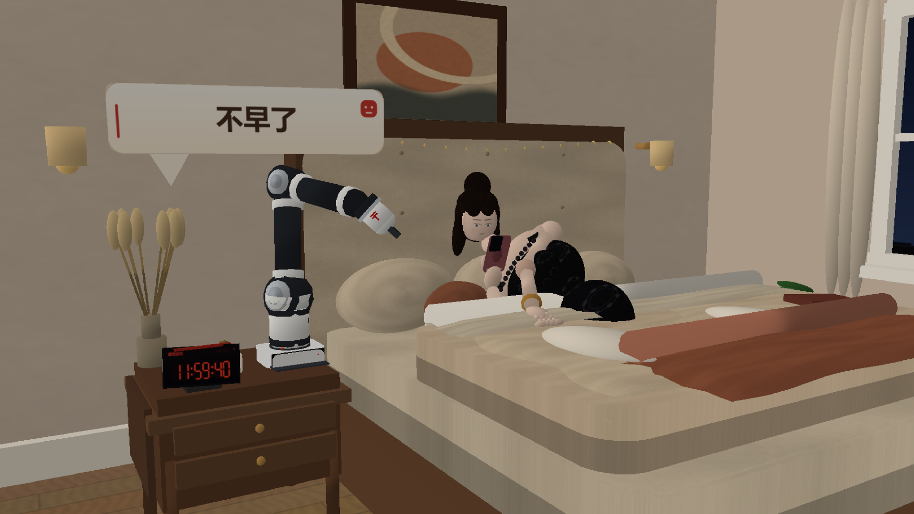
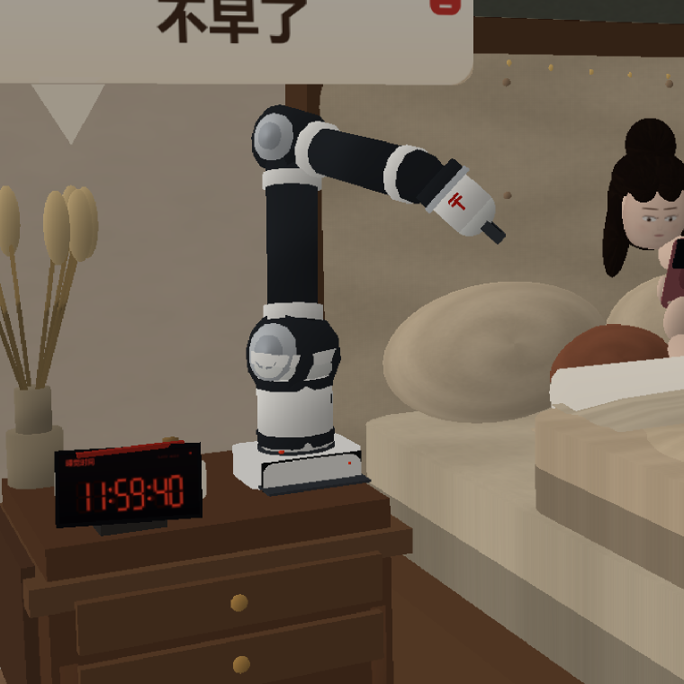
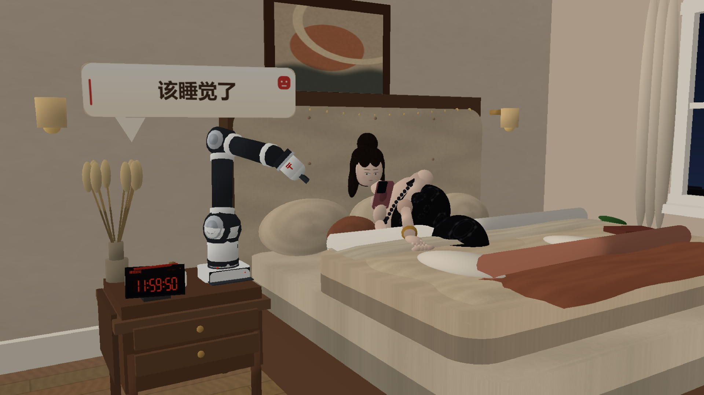
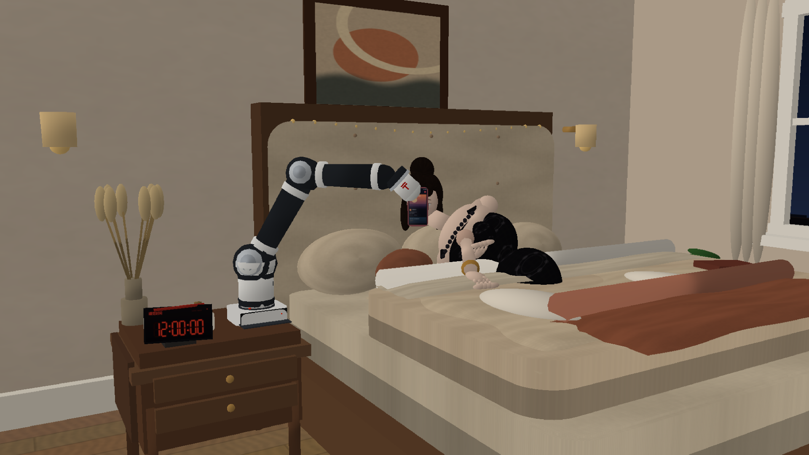
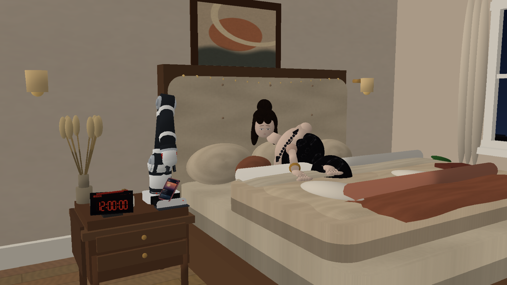
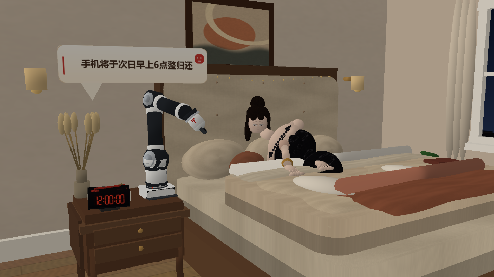

# 睡前守护机器人 · PyBullet 温馨卧室小剧场

一个完全由 Python + PyBullet 程序化搭建的睡前场景：

- 明亮、温暖的卧室：浅橡木地板、奶油色墙面、象牙色床品、床头板、枕头、床头柜、夜窗、壁灯和串灯
- 一个靠在枕头上玩手机的女人：表情更自然，会 **轻微眨眼**，并随剧情切换 **无所谓 / 难过 / 睡着**
- 一个放在床头柜上的白 / 深灰机械臂机器人：深色关节环、浅灰关节盖、白色绑带、
  带红色 **H** 标的白色末端，底座带抽屉式储物格
- 一个红色 LED 闹钟，从 `11:59:40` 走到 `12:00:00`
- 完整剧情：提醒 → 抢手机 → 开储物格收纳 → “次日6点归还” → 女人睡着 → 自动播放助眠曲



## 运行

```powershell
# 在项目根目录
.\.venv\Scripts\python.exe 夺机追梦者.py
```

依赖：`pybullet`、`numpy`。中文气泡、LED 闹钟和手机屏幕贴图已经生成在
`assets/` 中，不需要 Pillow 或联网。

如果纹理丢失，程序首次启动会自动重新生成 `assets/textures/` 下的
木纹、布料、皮肤和表情纹理；机械臂、家具和人物用到的 OBJ 网格会在运行时生成。

默认以 1920×1080 运行；如果窗口超出屏幕，可以改成：

```powershell
.\.venv\Scripts\python.exe 夺机追梦者.py --width 1600 --height 900
```

## 窗口操作

| 按键 | 作用 |
| --- | --- |
| 鼠标拖动 / 滚轮 | 旋转、缩放视角 |
| `SPACE` | 暂停 / 继续（会暂停助眠曲） |
| `R` | 从 11:59:40 重新播放 |
| `Q` 或 `ESC` | 退出 |

启动后会先停留 1.5 秒展示 **11:59:40** 与“不早了”，随后闹钟开始走；
闹钟每约 0.55 秒走一秒，所以从 11:59:40 到 12:00:00 大约需要 12.5 秒，
之后时间冻结在 12:00:00，完成抢手机与收纳的剧情。

## 剧情时间线

| 闹钟 | 剧情 |
| --- | --- |
| 11:59:40 | 闹钟显示 11:59:40，机器人显示“不早了”，女人面无表情地继续刷手机 |
| 11:59:50 | 机器人显示“该睡觉了”，女人仍不理会 |
| 12:00:00 | 机器人伸手夹走手机，女人表情变成难过，手落回被子上 |
| 之后 | 机器人把手机翻到屏幕朝外，移动到自身底座，打开抽屉储物格放入手机并关好 |
| — | 机器人显示“手机将于次日早上6点整归还” |
| — | 女人无可奈何地躺下，闭眼睡着；机器人显示“将为您播放助眠曲”，同时用 `winsound` 播放程序生成的音乐盒助眠曲 |

## 人物与表情

- 表情贴图以 1024×1024 重新绘制：柔化眉毛、眼线和唇色，减弱眼泪和嘴角的夸张程度
- 三种状态：**无所谓**（平静地看着手机）、**难过**（内眉轻抬、嘴角向下、眼部微湿）、**睡着**（闭眼、放松）
- 每 3～5 秒自然眨眼一次，每次约 0.1 秒；眨眼时只替换闭眼表情，不改变脸型或头部比例
- 呼吸、头部轻摆、拿手机的手部动作都保持小幅、自然

## 机器人外观



- 白色底座和立柱，带深色环带与浅灰关节盖
- 深灰碳黑色上臂 / 前臂，关节处为大型深色圆盘，外侧配浅灰圆形盖
- 白色绑带、深色腕环，白色圆柱形末端与浅色圆头
- 白色末端侧面有红色 **H** 标，末端下方是小巧的深色夹爪
- 底座抽屉式储物格保留完整功能：打开、放入手机、关闭、播放提示

## 文件结构

```
夺机追梦者.py          主场景、渲染、时间线、交互、音频、截图
woman_rig.py           女人姿态、手臂 IK、手部、脸与眨眼
robot_rig.py           白/深灰机械臂、关节、末端、夹爪与抽屉
meshgen.py             程序化 OBJ 网格（球、弧面、被子、圆角面板等）
textures.py            木纹、墙、布、蕾丝、头发、窗户、面部与眨眼纹理
pngutil.py             无依赖 PNG 写入工具
assets/                预生成的 UI 贴图、钟面、手机屏幕、助眠曲 WAV
renders/               剧情关键帧预览图（1920×1080，2× 超采样）
```

## 截图模式

```powershell
.\.venv\Scripts\python.exe 夺机追梦者.py --capture --times 0 5.6 14.0 16.5 17.8 20.6 --width 1920 --height 1080 --ssaa 2
```

`--times` 的单位是剧情秒；`--ssaa 2` 会以 2 倍分辨率渲染再下采样，边缘更干净。
只想要快速预览时可以加 `--ssaa 1`。

## 预览

| 11:59:40 | 11:59:50 |
| --- | --- |
|  |  |

| 12:00:00 抢手机 | 打开底座抽屉 |
| --- | --- |
|  |  |

| 6 点归还提醒 | 睡着并播放助眠曲 |
| --- | --- |
|  |  |

## 说明

- 这是一个用 PyBullet 内置 OpenGL 渲染器呈现的程序化场景，没有外部模型；
  所有家具、人物和机器人都由基本体、OBJ 网格和程序化贴图拼装。
- 音频通过 Windows `winsound` 异步循环播放；非 Windows 系统会保留画面并
  提示音频不可用。`assets/lullaby.wav` 可以单独试听。
- 如果运行时看到画面但听不到声音，请确认系统音量，或先运行
  `assets/lullaby.wav` 检查音频设备。
